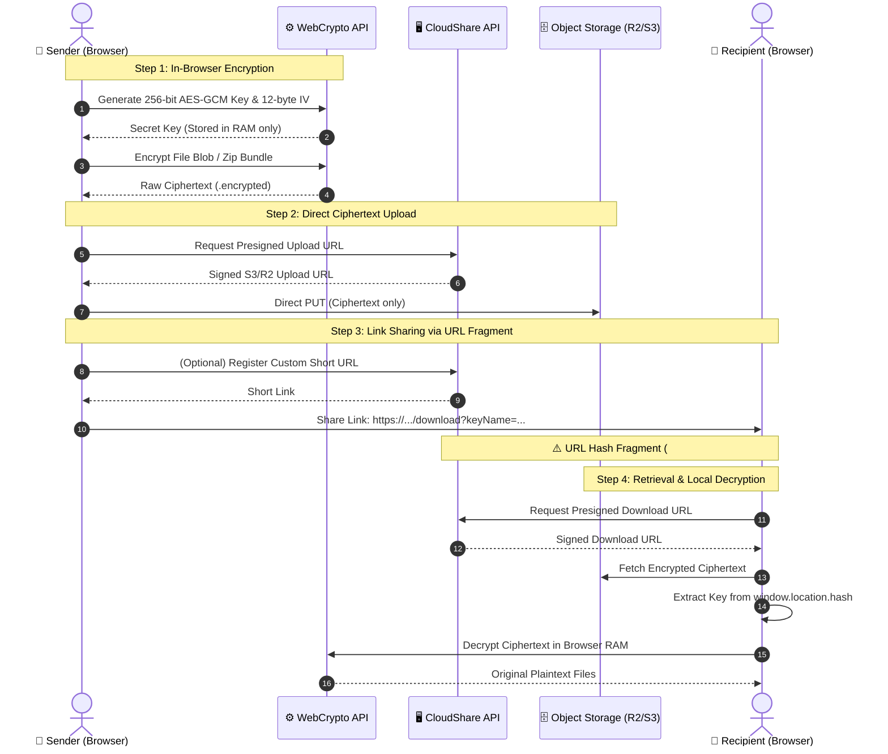

<div align="center">

  

  # CloudShare

  **Zero-Knowledge, Client-Side Encrypted Ephemeral File Sharing**

  An open-source, privacy-first platform that lets you encrypt files in your browser with AES-256-GCM, generate self-destructing links and QR codes, and share confidential bundles with zero footprint.

  <p align="center">
    <a href="https://cloudshare.swayamk.tech"><strong>Live Demo »</strong> cloudshare.swayamk.tech</a>
    <br />
    <br />
    <a href="#key-features">Key Features</a>
    ·
    <a href="#zero-knowledge-security-pipeline">Security Architecture</a>
    ·
    <a href="#quickstart">Quickstart</a>
    ·
    <a href="#environment-variables">Configuration</a>
    ·
    <a href="#tech-stack">Tech Stack</a>
  </p>

  <p align="center">
    <a href="https://cloudshare.swayamk.tech">
      
    </a>
    
    
    
  </p>

  <p align="center">
    
    
    
    
    
    
    
    
  </p>

</div>

---

## 📖 Overview

Standard cloud storage services hold your encryption keys, index file contents, log metadata, and require registered user accounts.

**CloudShare** operates on a **zero-knowledge principle**:

1. **Client-Side Encryption:** Files are compressed with JSZip and encrypted directly in your browser using the native **Web Crypto API (AES-256-GCM)** before upload.
2. **Key Isolation via URL Hash Fragment:** The raw encryption key is embedded strictly in the URL hash fragment (`https://.../download?...#key=...`). Per RFC 3986, **browsers never transmit hash fragments to servers** in HTTP request headers. Servers only receive opaque ciphertext.
3. **Automatic Purging:** Files automatically delete once their countdown timer elapses (1 minute to 24 hours) or when the download quota is reached (burn-after-reading).
4. **No Accounts or Tracking:** Zero user registration, zero tracking cookies, zero IP telemetry.

---

## ⚡ Key Features

| Feature | Description |
| :--- | :--- |
| 🛡️ **Zero-Knowledge AES-256-GCM** | Military-grade authenticated encryption computed entirely in-memory on the client device. Server never sees plaintext or keys. |
| 🔥 **Burn-After-Reading** | Set download limits (1, 5, 10, 50, etc.). File is automatically expunged from storage the moment the quota is exhausted. |
| ⏱️ **Auto-Destruction Timers** | Granular expiration policies (1 minute, 5 minutes, 1 hour, or 24 hours). Storage records are automatically cleaned up. |
| 📱 **Mobile QR Code Sharing** | Instant scan-to-download QR codes generated in-browser for quick device-to-device transfers. |
| 🔗 **Custom Short Vanity URLs** | Generate clean custom vanity paths (`/share/my-custom-name`) backed by high-speed Redis key resolution. |
| 📦 **Multi-File Bundle Zipping** | Select multiple files or folders up to 50MB; automatically zipped and encrypted as a unified cryptographic archive. |
| ⚡ **Direct Cloud Presigned Transfer** | Zero server bottlenecks — files upload and download directly to S3/R2 storage buckets via time-limited presigned URLs. |
| 🎨 **Solid, Premium Tech UI** | Fast, responsive interface built with Tailwind CSS, Radix UI primitives, Lucide icons, and zero-distraction solid styling. |

---

## 🔒 Zero-Knowledge Security Pipeline

The diagram below illustrates how encryption keys remain strictly client-side throughout the entire upload, storage, and retrieval lifecycle:



---

## 🛠️ Tech Stack

### Frontend
- **Framework:** [React 18](https://react.dev/) + [Vite](https://vitejs.dev/) + [TypeScript](https://www.typescriptlang.org/)
- **Styling:** [Tailwind CSS](https://tailwindcss.com/) + [Radix UI](https://www.radix-ui.com/)
- **Icons:** [Lucide React](https://lucide.dev/)
- **Cryptography:** Native browser [Web Crypto API](https://developer.mozilla.org/en-US/docs/Web/API/Web_Crypto_API) (`SubtleCrypto` AES-GCM)
- **Archive Compression:** [JSZip](https://stuk.github.io/jszip/)
- **QR Codes:** `react-qrcode-logo`

### Backend & Infrastructure
- **Runtime:** [Node.js](https://nodejs.org/) + [Express](https://expressjs.com/)
- **Storage:** [Cloudflare R2](https://www.cloudflare.com/developer-platform/r2/) / [AWS S3](https://aws.amazon.com/s3/) (S3-compatible presigned URLs)
- **Metadata & Short URLs:** [Upstash Redis](https://upstash.com/) (Serverless REST Redis)
- **Deployment:** Vercel / AWS CloudFront + S3 / AWS Lambda

---

## 🚀 Quickstart

### Prerequisites
- **Node.js** >= 18.0.0
- **npm** >= 9.0.0
- An S3-compatible bucket ([Cloudflare R2](https://www.cloudflare.com/products/r2/) or [AWS S3](https://aws.amazon.com/s3/))
- An [Upstash Redis](https://upstash.com/) database (free tier works great)

---

### 1. Clone the Repository

```bash
git clone https://github.com/swayam-kothekar/cloudshare-project.git
cd cloudshare-project
```

### 2. Configure Backend

```bash
cd backend
npm install
cp .env.example .env
```

Edit `backend/.env` with your storage and Redis credentials:

```ini
BACKEND_BASE_URL=http://localhost:3000
FRONTEND_BASE_URL=http://localhost:5173

# Cloudflare R2 / AWS S3
R2_ACCOUNT_ID=your_cloudflare_account_id
R2_ACCESS_KEY_ID=your_r2_access_key_id
R2_SECRET_ACCESS_KEY=your_r2_secret_access_key
R2_BUCKET_NAME=cloudshare-files

# Upstash Redis
UPSTASH_REDIS_REST_URL=https://your-instance.upstash.io
UPSTASH_REDIS_REST_TOKEN=your_upstash_token
```

Start the backend server:

```bash
npm start
# Server runs on http://localhost:3000
```

### 3. Configure Frontend

In a new terminal window:

```bash
cd frontend
npm install
cp .env.example .env
```

Edit `frontend/.env`:

```ini
VITE_API_BASE_URL=http://localhost:3000
VITE_FRONTEND_BASE_URL=http://localhost:5173
```

Start the Vite development server:

```bash
npm run dev
# Frontend runs on http://localhost:5173
```

Visit **http://localhost:5173** to upload, encrypt, and share files locally.

---

## ⚙️ Environment Variables

### Backend (`backend/.env`)

| Variable | Description | Required | Example |
| :--- | :--- | :---: | :--- |
| `BACKEND_BASE_URL` | Public base URL of the API server | Yes | `https://api.cloudshare.swayamk.tech` |
| `FRONTEND_BASE_URL` | Public base URL of the web client | Yes | `https://cloudshare.swayamk.tech` |
| `R2_ACCOUNT_ID` | Cloudflare account ID for R2 | Yes | `a1b2c3d4e5f6...` |
| `R2_ACCESS_KEY_ID` | S3/R2 API Access Key ID | Yes | `0123456789abcdef` |
| `R2_SECRET_ACCESS_KEY` | S3/R2 API Secret Access Key | Yes | `9876543210fedcba` |
| `R2_BUCKET_NAME` | S3/R2 bucket name for ciphertext | Yes | `cloudshare-files` |
| `UPSTASH_REDIS_REST_URL` | Upstash Redis REST endpoint | Yes | `https://prompt-tiger-1234.upstash.io` |
| `UPSTASH_REDIS_REST_TOKEN` | Upstash Redis authentication token | Yes | `AX6gASQg...` |

### Frontend (`frontend/.env`)

| Variable | Description | Required | Example |
| :--- | :--- | :---: | :--- |
| `VITE_API_BASE_URL` | Base endpoint URL for the backend API | Yes | `https://api.cloudshare.swayamk.tech` |
| `VITE_FRONTEND_BASE_URL` | Public origin URL for building links | Yes | `https://cloudshare.swayamk.tech` |

---

## 📂 Project Structure

```text
cloudshare-project/
├── backend/
│   ├── app.js                   # Express application entrypoint & middleware
│   ├── generateUploadUrl.js     # Generates S3/R2 presigned upload URLs
│   ├── generateDownloadUrl.js   # Generates S3/R2 presigned download URLs
│   ├── generateShortUrl.js      # Vanity short link generation via Upstash Redis
│   ├── tagFile.js               # Tracks file metadata and download quotas
│   └── package.json
│
├── frontend/
│   ├── src/
│   │   ├── components/
│   │   │   ├── Navbar.tsx       # Sticky navigation header with solid branding
│   │   │   ├── Hero.tsx         # Hero section with interactive security pipeline
│   │   │   ├── HowItWorks.tsx   # 4-step workflow walkthrough
│   │   │   ├── Features.tsx     # Bento grid of privacy capabilities
│   │   │   ├── FAQ.tsx          # Interactive accordion security FAQ
│   │   │   ├── Footer.tsx       # Clean footer with privacy badge
│   │   │   ├── Icons.tsx        # Bespoke geometric CloudShare brand mark
│   │   │   ├── ScrollToTop.tsx  # Smooth scroll-to-top button
│   │   │   └── ui/              # Radix UI primitives (Button, Dialog, Accordion)
│   │   ├── FileUpload.tsx       # In-browser client AES encryption & dropzone
│   │   ├── FileDownload.tsx     # In-browser client AES decryption & file saver
│   │   ├── LandingPage.tsx      # Main marketing showcase page
│   │   ├── assets/              # Brand SVG assets and logos
│   │   └── App.tsx              # React router routing configuration
│   ├── index.html
│   ├── tailwind.config.js
│   ├── vite.config.ts
│   └── package.json
│
└── README.md
```

---

## 🔐 Cryptographic Specifications

- **Cipher:** `AES-GCM` (Galois/Counter Mode)
- **Key Length:** 256 bits (`AES-256`)
- **Initialization Vector (IV):** 12 bytes cryptographically secure random bytes via `crypto.getRandomValues()`
- **Authentication Tag:** 128 bits (ensures ciphertext integrity and prevents tampering)
- **Key Derivation / Export:** Raw key is base64url-encoded and appended as the URL hash:
  ```text
  https://cloudshare.swayamk.tech/download?keyName=uuid.encrypted#key=BASE64URL_KEY
  ```
- **Zero-Storage of Keys:** The hash part (`#key=...`) is processed entirely by the recipient's browser JavaScript engine. It is never logged in web server access logs, reverse proxies, or cloud monitoring systems.

---

## 🤝 Contributing

Contributions are welcome! If you would like to report an issue, suggest a feature, or submit a pull request:

1. Fork the repository
2. Create your branch: `git checkout -b feature/amazing-feature`
3. Commit your changes: `git commit -m 'Add amazing feature'`
4. Push to your branch: `git push origin feature/amazing-feature`
5. Open a Pull Request

---

## 📄 License

This project is licensed under the [MIT License](LICENSE).

---

<div align="center">
  <sub>Built with care for privacy and open-source software by <a href="https://github.com/swayam-kothekar">Swayam Kothekar</a>.</sub>
</div>
